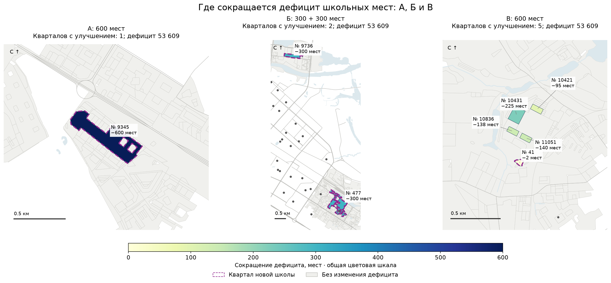

# Домашнее задание №3. Приложение для оценки вариантов размещения школ в Тюмени

**Курс «Технологии искусственного интеллекта в урбанистике», ИТМО.**

Продолжение [исследования кварталов Тюмени](https://github.com/axxlv/tyumen-blocksnet). В отдельной версии уточнены школьные точки и оценочная вместимость зданий, исправлено распознавание жилья. На этой базе создано локальное браузерное приложение для сравнения размещения новых школ.

## Готовый результат

- [Итоги эксперимента: ноутбук с сохранёнными таблицами и картами](school-placement/experiment_results.ipynb).
- [Отчёт по обязательным сценариям А, Б, В](school-placement/state/experiment-results/EXPERIMENT_REPORT.md).
- [Дополнительные А* и Б*](school-placement/state/experiment-results/additional/ADDITIONAL_SCENARIOS.md).
- [Обновлённая прошлая работа: выполненный ноутбук](python-package-boilerplate-updated/examples/tyumen_pipeline_refined.ipynb).
- [Готовый дашборд прошлой работы](python-package-boilerplate-updated/examples/data_tyumen/dashboard_refined.html): для интерактивного просмотра скачайте HTML и откройте браузером.
- [Сверка с заданиями преподавателя](submission/REQUIREMENTS_REVIEW.md).

Приложение запускается на компьютере через Python. Адреса после запуска: `http://127.0.0.1:8767/` — размещение школ; `http://127.0.0.1:8767/practice2` — обновлённый дашборд. Это локальные адреса, а не размещённые в интернете сайты.

## Цель

Сравнить размещение одной школы на 600 мест и двух школ по 300 мест. Найти кварталы для одной школы, максимально сокращающие суммарный дефицит школьных мест с учётом доступности. Сохранить ручной выбор и обоснования до автоматического поиска; сопоставить результаты на карте и в таблицах.

## Что получилось

| Показатель | Результат |
|---|---:|
| Кварталов | 12 805 |
| Модельное население | 1 197 166 |
| Существующих школьных зданий | 82 |
| Оценочная вместимость | 106 942 места |
| Нормативная потребность | 146 028 мест |
| Покрыто в пределах 15 минут | 91 819 мест |
| Исходный дефицит | 54 209 мест |
| Проверено автоматическим поиском | 12 805 из 12 805 |
| Ошибок поиска | 0 |
| Равноценных лучших кварталов для школы 600 мест | 2 877 |

В обновлённой версии прежние одинаковые 250 мест на школу заменены индивидуальными оценками CSV. Увеличение модельного населения относительно прошлой версии связано с распознаванием застройки, а не с измеренным демографическим ростом.

## Эксперимент и выводы

| Сценарий | Размещение | Добавлено мест | Остаточный дефицит | Сокращение |
|---|---|---:|---:|---:|
| А | № 9345 | 600 | 53 609 | 600 |
| Б | № 9736 и № 477 | 300 + 300 | 53 609 | 600 |
| В | № 41, один из лучших | 600 | 53 609 | 600 |
| А* | № 9345 | 1600 | 52 609 | 1600 |
| Б* | № 9736 и № 477 | 1000 + 1000 | 52 732 | 1477 |

- В обязательном сравнении А/Б/В все варианты равны по сокращению общего дефицита, но улучшают разные кварталы: 1, 2 и 5 соответственно. Ручной А входит в множество лучших. В выбран как минимальный ID среди равных — единственного оптимума нет.
- В варианте В 2 места покрывают собственную потребность квартала № 41, а 598 получают соседние кварталы. Повторный ручной расчёт воспроизвёл автоматический результат.
- У А* и Б* собственная потребность выбранных кварталов закрыта, есть улучшения у соседей. Оба улучшают семь кварталов. Объёмы добавления различаются (1600 и 2000), поэтому это отдельные опыты после основного поиска, а не замена сравнения одинаковых 600 мест.
- Ухудшений по кварталам в пяти сохранённых сценариях нет. Даже основной лучший вариант сокращает исходный общий дефицит лишь примерно на 1,11%.



## Методика

1. Прочитаны сохранённые кварталы, население, вместимость и матрица времени в пути обновлённой практики 2; проверены уникальность и порядок ID.
2. Воспроизведён исходный расчёт `competitive_provision` в BlocksNet **1.0.0a9**. Потребность — **120 мест на 1000 жителей**, округление вверх по кварталу; доступность — **15 минут пешком**, `self_supply=True`, `max_depth=1`.
3. Новая школа увеличивает вместимость выбранного квартала. Сначала покрывается его собственная потребность, затем остаток участвует в конкурентном распределении между доступными кварталами. Население, матрица и нормативы в сценариях не меняются.
4. Каждый из 12 805 автоматических вариантов проверен независимо от исходного состояния. Критерий — сокращение суммарного `demand_left`. Все равные лучшие показаны с допуском 1e-7 места.
5. Оптимизации сохраняют CBC, веса, ограничения и порядок задачи. На контрольных сценариях проверено совпадение результатов по кварталам и идентичность MPS. Новые А*/Б* также сверены с оригинальным BlocksNet.

## Источники

| Данные | Источник и примечание |
|---|---|
| Территория, здания, дороги, функциональные зоны | OpenStreetMap, локальный PBF Geofabrik; © OpenStreetMap contributors, ODbL 1.0 |
| Школьные точки и вместимость | Пользовательский `tyumen_schools_82.csv`; методы и достоверность сохранены для каждого здания |
| Кварталы и расчётные показатели | BlocksNet 1.0.0a9 и сохранённые результаты предыдущей работы |
| Постановка | [Практика 2](https://github.com/Mvin8/ai-technologies-in-urbanism/blob/main/content/practice/practice-02.qmd), [практика 3](https://github.com/Mvin8/ai-technologies-in-urbanism/blob/main/content/practice/practice-03.qmd) |

## Структура файлов

```text
.
├── README.md
├── OPEN_PROJECT.ps1
├── school-placement/
│   ├── server.py, engine.py           # приложение и расчётный движок
│   ├── web/                          # интерфейс
│   ├── full_school_search.ipynb       # запуск/продолжение поиска
│   ├── experiment_results.ipynb      # сохранённые итоги без нового расчёта
│   ├── requirements-lock.txt
│   └── state/experiment-results/     # отчёт, карты, рейтинг, CSV сценариев
│       └── additional/               # А* и Б*
├── python-package-boilerplate-updated/
│   ├── pyproject.toml
│   └── examples/
│       ├── tyumen_pipeline_refined.ipynb
│       ├── tyumen_dashboard_refined.py
│       └── data_tyumen/
│           ├── dashboard_refined.html
│           └── refined/              # GeoJSON, CSV, исходные оценки и аудиты
└── submission/                       # проверка требований и порядок показа
```

## Повторный запуск

Для просмотра итогов достаточно ноутбуков с сохранёнными выводами, Markdown, CSV и PNG. Открывать полный поиск заново не требуется.

Для работающего приложения нужен **полный комплект данных**, Python 3.12 и окружение BlocksNet. Снимок рабочего Windows-окружения — `requirements-lock.txt` внутри проекта. Из корня распакованного комплекта:

```powershell
powershell -ExecutionPolicy Bypass -File ".\OPEN_PROJECT.ps1" -Python "C:\путь\Scripts\python.exe" -Port 8767
```

Откройте `http://127.0.0.1:8767/`. Сохранённые А/Б/В/А*/Б* доступны в блоке «Сохранённые сценарии». Полный поиск этой командой не запускается.

Обновлённый ноутбук прошлой практики по умолчанию только читает готовые данные и показывает все группы показателей. Исторический полный пайплайн сохранён отдельно: он использует прежние правила и не должен запускаться поверх текущей базы. Сборка дашборда из готовых данных:

```powershell
python .\python-package-boilerplate-updated\examples\tyumen_dashboard_refined.py
```

## Крупные файлы

Матрица Parquet (332 783 645 байт) и SQLite-база с завершённым поиском передаются в полном архиве `COMPLETE_PROJECT_WITH_DATA.zip`. Архив загружается в [Releases этого репозитория](https://github.com/axxlv/tyumen-school-placement/releases); после проверки загрузки здесь будет прямая ссылка на скачивание.

Содержимое полного архива распаковывается с сохранением структуры папок. Среда Python в архив не копируется. Чистая установка на другом компьютере не проверялась; иная ОС, версии пакетов или бинарник CBC могут изменить подпись совместимости, тогда прежние сценарии будут архивными. Сохранённые CSV/HTML/карты остаются доступными.

## Ограничения

- Население рассчитано по жилой площади, часть жилого назначения восстановлена по контексту; недостаток сведений не равен отсутствию жителей.
- Вместимости школ оценочные и разной достоверности. Это не единый реестр подтверждённых проектных мощностей и не официальная оценка обеспеченности Тюмени.
- Исторический пешеходный граф построен из локального OSM/PBF. Требование прошлой практики о скачанном готовом графе буквально не выполнено; эта оговорка не скрывается. Интермодальный граф не используется.
- Приложение сравнивает кварталы, но не выбирает участок. Наличие земли, стоимость, фактическая загрузка школ, демографический прогноз и возможность строительства требуют отдельного обоснования.

## План работы и запросы агенту

Порядок: проверка прежнего проекта → обновление школ и населения → воспроизведение исходного расчёта → приложение и ручные варианты → проверка эквивалентности и скорости → запись выбора А/Б → полный поиск → повторная проверка В → отчёт → дополнительные А*/Б*.

Основные требования пользователя: «Используй приложенный CSV как новый основной набор школ»; «Не заменяй пространственный расчёт простым вычитанием вместимости»; «полный независимый перебор всех 12 805 кварталов обязателен»; «Прошлые варианты остаются там же». Исходные варианты и обоснования А/Б сохранены до поиска; дополнительные опыты оформлены отдельно.

Видео и ссылки преподавателю передаются пользователем самостоятельно. Инструкция показа: [submission/VIDEO_GUIDE.md](submission/VIDEO_GUIDE.md).
