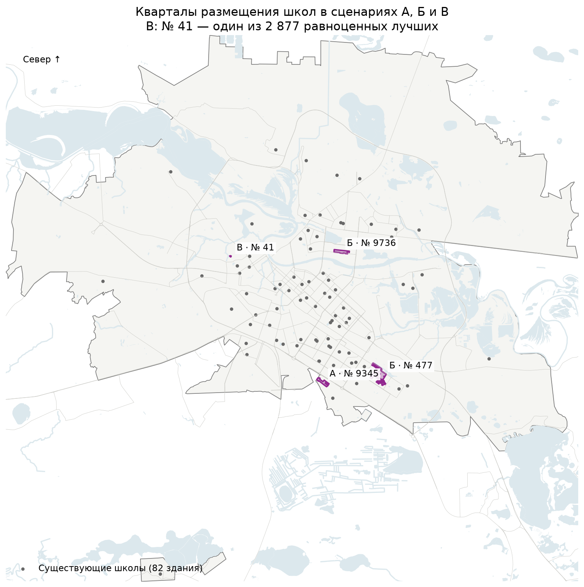
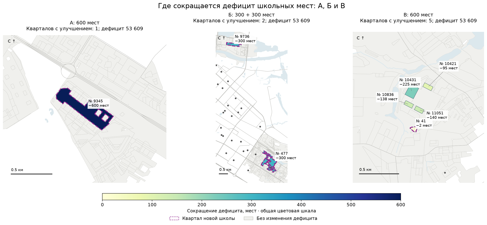

# Эксперимент размещения школ: А, Б, В

Полный независимый перебор завершён: 12805 из 12805 кварталов, ошибок 0. Вместимость новой школы: 600 мест.
Подпись исходных данных и метода: `40be9ac1cd0ef63d9ee985d8baa0a83ffe66b6bb4a880fedc080b81c387f87e7`.

Равноценных лучших кварталов: **2877**. Для отображения В выбран № **41** — минимальный ID среди равноценных лучших; это не утверждение единственного оптимума. Полный список: equal-best.csv.

Повторный ручной расчёт В воспроизвёл результат поиска: дефицит 53 609, сокращение 600 мест.

| Состояние | Прирост мест | Дефицит | Сокращение | Кварталов с улучшением | С ухудшением |
|---|---:|---:|---:|---:|---:|
| Исходное состояние | 0 | 54209 | 0 | 0 | 0 |
| А | 600 | 53609 | 600 | 1 | 0 |
| Б | 600 | 53609 | 600 | 2 | 0 |
| В | 600 | 53609 | 600 | 5 | 0 |

Ручной квартал А № 9345 входит в множество равноценных лучших одиночных размещений.
А, Б и В равны по сокращению общего дефицита (600 мест). Это равенство по выбранному критерию, а не одинаковое пространственное распределение улучшений. Автоматический подбор пары школ не выполнялся.
Сумма времени всех вариантов: 75.01 минуты, из кэша 0. Время включает вычисления варианта и чтение кэша, но не финальную транзакцию записи каждого результата; это не точное полное время по часам.
Вариант В повторно рассчитан вручную; все показатели всех кварталов также сверены с оригинальной функцией BlocksNet.
Покрытие нормативной потребности: 62.88% → 63.29%. Общий дефицит сокращён на 1.11%, значительная часть потребности остаётся непокрытой.

## Зафиксированный выбор до поиска

А: Выбор подтверждён пользователем в чате до автоматического поиска. Квартал № 9345: плотная многоэтажная жилая застройка у улиц Федюнинского, Павла Шарова и Александра Митинского; модельное население 9183, текущий дефицит 1102 места, собственная вместимость школ 0. Проверяется сосредоточение 600 новых мест в одном крупном очаге дефицита. Оценка населения содержит неопределённость назначения части зданий.

Б: Выбор подтверждён пользователем в чате до автоматического поиска. Две разнесённые территории: № 9736 у улицы Тимофея Кармацкого (модельное население 5036, дефицит 605 мест) и № 477 у улиц Ивана Словцова, Таллинской и 30 лет Победы (3939 жителей, дефицит 473 места). В обоих кварталах собственная вместимость школ 0. Проверяется распределение одинакового суммарного прироста 600 мест между северной и юго-восточной территориями. Для № 477 сохраняется неопределённость назначения части зданий.

## Изменения по кварталам

А: наибольшее сокращение дефицита — № 9345: 600 мест.

Б: наибольшее сокращение дефицита — № 477: 300 мест, № 9736: 300 мест.

В: наибольшее сокращение дефицита — № 10431: 225 мест, № 11051: 140 мест, № 10836: 138 мест, № 10421: 95 мест, № 41: 2 мест.

## Ограничения
Население оценено по жилой площади; часть жилых зданий определена по контексту, часть назначения не установлена. Нулевое модельное население при недостатке данных не доказывает отсутствие жителей. Вместимость 82 зданий школ (106942 места) оценочная, методы и достоверность различаются; это не единый реестр подтверждённых проектных мощностей.
Расчёт BlocksNet 1.0.0a9: 120 мест на 1000 жителей с округлением вверх по кварталу, 15 минут пешком, self_supply=True, max_depth=1. Конкурентное распределение не гарантирует равномерного покрытия; 0/1 — результат распределения модельной потребности.
Выбор земельного участка и возможность строительства не оценивались и требуют отдельного градостроительного обоснования.

Файлы: comparison.csv, baseline.csv, scenario-А.csv, scenario-Б.csv, scenario-В.csv, ranking-all-12805.csv, equal-best.csv, experiment-validation.json.

## Карты

Масштабы локальных карт различаются; на каждой есть масштабная линейка. Цветовая шкала сокращения дефицита общая, 0–600 мест. Фиолетовый контур — квартал добавления школы; точки — существующие школьные здания. Это квартальное размещение, а не выбранный земельный участок.

В варианте В исходная потребность квартала № 41 составляет лишь 2 места. Из добавленных 600 мест 2 обслуживают сам квартал, а 598 сокращают дефицит соседей: № 10431 — 225, № 11051 — 140, № 10836 — 138, № 10421 — 95 мест. Собственный дефицит квартала поэтому не заменяет пространственный критерий поиска. В А и Б новые места используются для собственных потребностей выбранных кварталов.

## Где дефицит сохраняется

А: кварталов с остаточным дефицитом — 2875. Наибольшие значения: № 9736: 605 мест, № 6688: 514 мест, № 9345: 502 мест, № 477: 473 мест, № 2085: 436 мест.

Б: кварталов с остаточным дефицитом — 2875. Наибольшие значения: № 9345: 1102 мест, № 6688: 514 мест, № 2085: 436 мест, № 58: 423 мест, № 11000: 385 мест.

В: кварталов с остаточным дефицитом — 2871. Наибольшие значения: № 9345: 1102 мест, № 9736: 605 мест, № 6688: 514 мест, № 477: 473 мест, № 2085: 436 мест.

## Проверки и просмотр

Проверена полнота набора ID рейтинга, ноль ошибок, совпадение подписи данных и метода, фиксация А/Б до старта поиска. В повторно рассчитанном В совпали итог поиска и все показатели всех 12805 кварталов с оригинальной функцией BlocksNet. Проверены три сохранённых сценария в браузере: карта, карточки, итоговые суммы, все 2877 равноценных лучших; JavaScript-ошибок нет. CSV варианта В, скачанный через интерфейс, сверён по всем строкам и полям с сохранённой таблицей.

Откройте http://127.0.0.1:8767/, обновите страницу и выберите строку А, Б или В в таблице сохранённых сценариев. Для сравнения пространственных изменений переключите карту на «Изменение». Рейтинг завершённого автоматического поиска и все равноценные лучшие остаются доступны в том же приложении. Вариант В сохранён под именем «В — автоматический поиск, квартал 41, один из 2877 равноценных лучших».

Полный перебор повторно не запускался. Исходные данные, нормативы, движок и записи А/Б не изменялись. Публикация в GitHub и отправка преподавателю этим этапом не выполнялись.

## Как открыть именно результат сценария

Кнопки А/Б в блоке записанных обоснований теперь открывают соответствующий сохранённый расчёт, а не только редактируемый план. При открытии результата карта переходит в режим «Изменение» и охватывает все затронутые кварталы; таблица сортируется по сокращению дефицита. Планы и расчётные значения не изменялись. Проверено в браузере без POST-запросов и нового расчёта.

В А потребность квартала 9345 — 1102 места: 600 новых покрывают часть собственной потребности, остаток 502. В Б дефицит 9736: 605→305, квартала 477: 473→173. При self_supply=True новые места сначала обслуживают свой квартал; во всех выбранных А/Б собственной потребности больше добавленной вместимости, поэтому новых свободных мест для соседей нет. У В потребность своего квартала лишь 2 места, и 598 новых мест получают соседи. Задание сравнивает результат фиксированных 600 мест, а не требует полного устранения дефицита каждого квартала или города.

Дополнительные опыты А* (1600 мест) и Б* (2×1000 мест) сохранены отдельно: [дополнение](additional/ADDITIONAL_SCENARIOS.md). Основное сравнение А/Б/В остаётся прежним.
